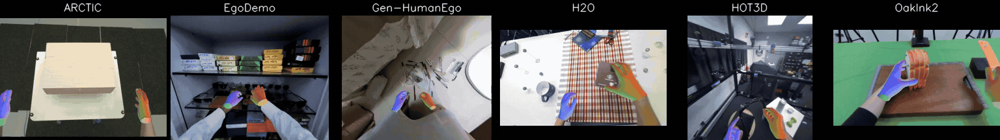

# EgoHandBench

[](https://egohandbench.github.io/)

EgoHandBench is a benchmark for egocentric 3D hand reconstruction. It converts seven public datasets into the same format, removes frames with low-quality annotations, and fixes the train/test splits. It also provides the evaluator and ready-to-run baselines.



## Quick Start

```bash
conda create -n egohandbench python=3.10 -y
conda activate egohandbench
pip install --no-build-isolation -r requirements.txt
pip install --no-build-isolation -r baselines/wilor/requirements.txt
# pip install --no-build-isolation -r baselines/{method_name}/requirements.txt
```

See [demo.ipynb](demo.ipynb) for image, video, and streaming examples.

[Hand2World Cam](https://github.com/NTUYWANG103/Hand2World/blob/master/hand2world_demo/hand2world-cam/README.md) provides live iPhone camera parameters.

Mesh visualization runs on CPU, with optional GPU acceleration through [nvdiffrast](https://github.com/NVlabs/nvdiffrast).

### Supported Models


| Baseline Name                 | Version                    | Offline FPS | Best Score    | Paper                                                                                                                                                               |
| ----------------------------- | -------------------------- | ----------- | ------------- | ------------------------------------------------------------------------------------------------------------------------------------------------------------------- |
| ACE-Ego-Hand (`ace_ego_hand`) | `egohandbench`             | 56.75       | 82.90         | [arXiv 2026](https://arxiv.org/abs/2608.20308)                                                                                                                      |
| ViDiHand V1 (`vidihand_v1`)   | `egohandbench`             | 2.55        | 80.85         | [NeurIPS 2026](https://arxiv.org/abs/2606.30308)                                                                                                                    |
| InfiniHand (`infinihand`)     | `official`, `egohandbench` | 7.78        | 79.19         | [arXiv 2026](https://arxiv.org/abs/2609.35743)                                                                                                                      |
| MINT (`mint`)                 | `official`, `egohandbench` | 23.10       | 76.46         | [arXiv 2026](https://arxiv.org/abs/2609.04958)                                                                                                                      |
| WiLoR (`wilor`)               | `official`, `egohandbench` | 21.30       | 75.37         | [CVPR 2025](https://openaccess.thecvf.com/content/CVPR2025/html/Potamias_WiLoR_End-to-end_3D_Hand_Localization_and_Reconstruction_in-the-wild_CVPR_2025_paper.html) |
| EgoHandICL (`egohandicl`)     | `egohandbench`             | 3.46        | 75.15         | [ICLR 2026](https://arxiv.org/abs/2601.19850)                                                                                                                       |
| HandFlow (`handflow`)         | `official`, `egohandbench` | 24.43       | 72.97         | [arXiv 2026](https://arxiv.org/abs/2607.11221)                                                                                                                      |
| AnyHand (`anyhand`)           | `official`, `egohandbench` | 14.34       | 72.91         | [NeurIPS 2026](https://arxiv.org/abs/2603.25726)                                                                                                                    |
| PAD-Hand (`pad_hand`)         | `official`, `egohandbench` | 11.68       | 70.55         | [CVPR 2026](https://openaccess.thecvf.com/content/CVPR2026/html/Ismayilzada_PAD-Hand_Physics-Aware_Diffusion_for_Hand_Motion_Recovery_CVPR_2026_paper.html)         |
| HaMeR (`hamer`)               | `official`, `egohandbench` | 1.68        | 68.60         | [CVPR 2024](https://openaccess.thecvf.com/content/CVPR2024/html/Pavlakos_Reconstructing_Hands_in_3D_with_Transformers_CVPR_2024_paper.html)                         |
| HandDGP (`handdgp`)           | `official`, `egohandbench` | 68.21       | 65.80         | [ECCV 2024](https://arxiv.org/abs/2407.15844)                                                                                                                       |
| Dyn-HaMR (`dyn_hamr`)         | `official`, `egohandbench` | 6.46        | 65.38         | [CVPR 2025](https://openaccess.thecvf.com/content/CVPR2025/html/Yu_Dyn-HaMR_Recovering_4D_Interacting_Hand_Motion_from_a_Dynamic_Camera_CVPR_2025_paper.html)       |
| EgoForce (`egoforce`)         | `official`, `egohandbench` | 9.91        | 64.09         | [SIGGRAPH 2026](https://arxiv.org/abs/2605.12498)                                                                                                                   |
| InterWild (`interwild`)       | `official`, `egohandbench` | 24.85       | 60.89         | [CVPR 2023](https://openaccess.thecvf.com/content/CVPR2023/html/Moon_Bringing_Inputs_to_Shared_Domains_for_3D_Interacting_Hands_Recovery_CVPR_2023_paper.html)      |
| WildHands (`wildhands`)       | `official`, `egohandbench` | 1.64        | 60.61         | [ECCV 2024](https://www.ecva.net/papers/eccv_2024/papers_ECCV/html/10034_ECCV_2024_paper.php)                                                                       |
| OmniHands (`omnihands`)       | `official`, `egohandbench` | 1.59        | 54.77         | [ACM TOG 2026](https://arxiv.org/abs/2405.20330)                                                                                                                    |
| HaWoR (`hawor`)               | `official`, `egohandbench` | 8.84        | 51.13         | [CVPR 2025](https://openaccess.thecvf.com/content/CVPR2025/html/Zhang_HaWoR_World-Space_Hand_Motion_Reconstruction_from_Egocentric_Videos_CVPR_2025_paper.html)     |
| Hamba (`hamba`)               | `official`, `egohandbench` | 1.42        | 44.89         | [NeurIPS 2024](https://arxiv.org/abs/2407.09646)                                                                                                                    |


`official` uses the released weights and `egohandbench` is trained only on the EgoHandBench train splits.  
See [baselines/README.md](baselines/README.md) for more details.

## Benchmark

Download our processed data from [Hugging Face](https://huggingface.co/datasets/WANG-XIXI/EgoHandBench) into `datasets/`  use command: 

```bash
python -m utils.download_data
```


| Dataset               | `--dataset`               | Train/Test Setting | Original Source                                                                    |
| --------------------- | ------------------------- | ------------------ | ---------------------------------------------------------------------------------- |
| ARCTIC                | `arctic`                  | In-domain          | [Project](https://arctic.is.tue.mpg.de/)                                           |
| EgoDemo — EgoPro      | `egodemo_egopro_standard` | In-domain          | [LightwheelAI/EgoDemo](https://huggingface.co/datasets/LightwheelAI/EgoDemo)       |
| EgoDemo — EgoStandard | `egodemo_egostandard`     | In-domain          | [LightwheelAI/EgoDemo](https://huggingface.co/datasets/LightwheelAI/EgoDemo)       |
| H2O                   | `h2o`                     | In-domain          | [Project](https://h2odataset.ethz.ch/)                                             |
| HOT3D                 | `hot3d`                   | In-domain          | [Project](https://facebookresearch.github.io/hot3d/)                               |
| OakInk2               | `oakink2`                 | In-domain          | [Repository](https://github.com/oakink/OakInk2)                                    |
| Gen-HumanEgo          | `gen_humanego_1h`         | In-the-wild        | [GenRobot/Gen-HumanEgo](https://huggingface.co/datasets/genrobot2025/Gen-HumanEgo) |


Train/test splits: `datasets/{dataset}/manifests/split.json` (Gen-HumanEgo is test-only).

Run inference on one dataset, then evaluate:

```bash
python inference.py --method wilor --version official --dataset h2o
python -m metrics.evaluator --gt datasets/h2o/mano --pred results/h2o/wilor/official/joint
```

Optionally, render the predictions:

```bash
python -m utils.visualizer --video datasets/h2o/mp4/rgb_480p \
  --mano results/h2o/wilor/official/mano --camera datasets/h2o/cameras_json \
  --output results/h2o/wilor/official/preview
```

Use `--joint results/h2o/wilor/official/joint` in place of `--mano` to render the joints.

## SLAM

If your videos come without camera calibration, we recommend estimating the intrinsics with one of the following tools and saving them in the same camera JSON format as the examples in [datasets/sample/](datasets/sample/):

- [ViPE](https://github.com/nv-tlabs/vipe)
- [Depth Anything 3](https://github.com/ByteDance-Seed/Depth-Anything-3)
- [DROID-SLAM](https://github.com/princeton-vl/DROID-SLAM)

## Contact

If you have any questions, feel free to contact [YWANG103@e.ntu.edu.sg](mailto:YWANG103@e.ntu.edu.sg).
